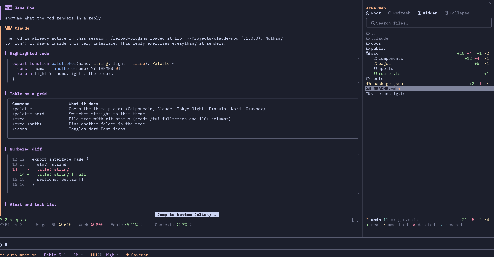
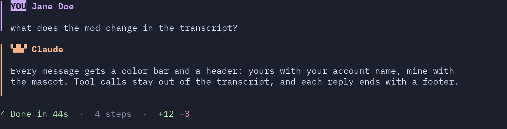
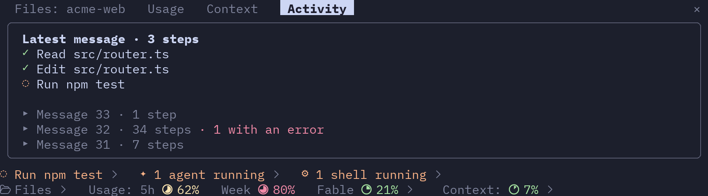
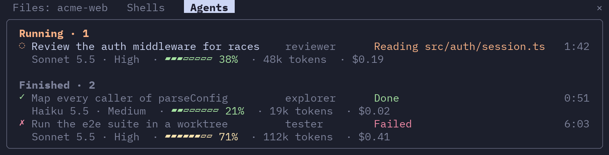
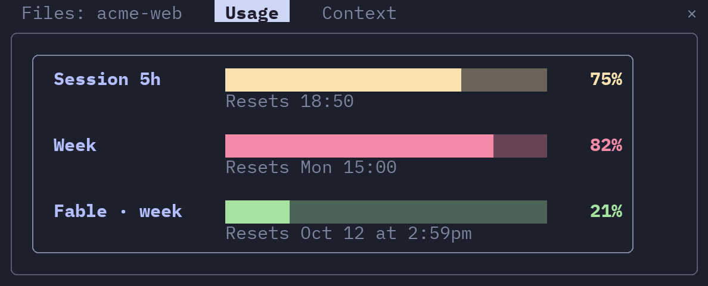
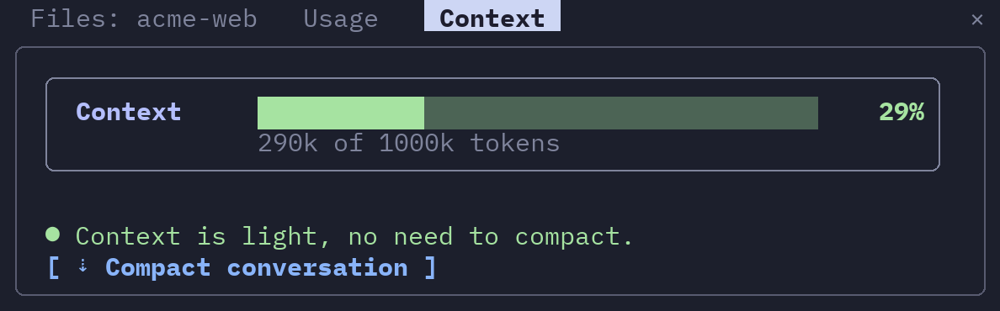
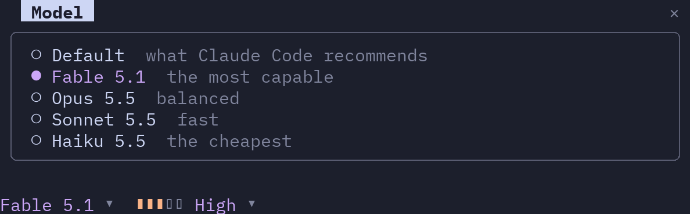
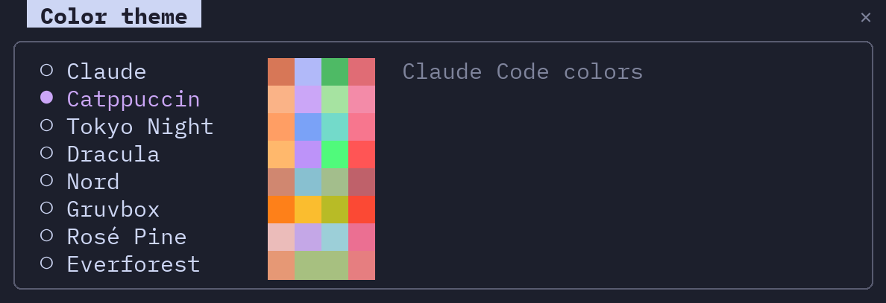
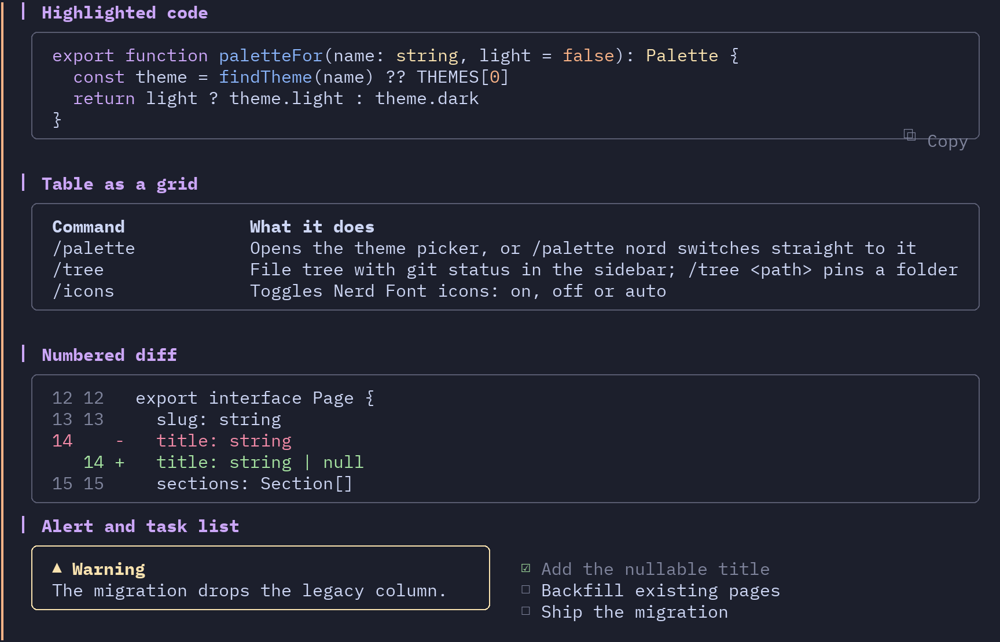
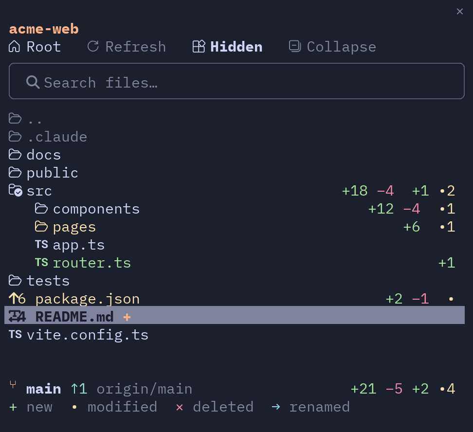

# friendly-ui

A friendlier interface for [Claude Code](https://claude.com/claude-code): named messages, color
themes, replies drawn with code highlighting, tables, diffs and diagrams, tool activity and
background work in panes, account usage and context at a glance, model and effort pickers, and a
file tree with git status in the sidebar.



## Install

```
/plugin marketplace add dazza-dev/claude-mod
/plugin install friendly-ui@claude-mod
```

Then restart Claude Code. To update later: `/plugin marketplace update claude-mod` and reinstall,
or `/reload-plugins` when developing from a local clone (`claude --plugin-dir <clone>`).

Recommended: turn off Claude Code's spinner tips (`"spinnerTipsEnabled": false` in
`~/.claude/settings.json`), since the mod shows the current step above the prompt.

## What it does

### Messages with a color bar

Yours with your account name, Claude's with its mascot. Each reply ends with its duration, steps,
and lines added and removed.



### Tools out of the transcript

Tool calls do not clutter the conversation. An indicator above the prompt shows the current step
and opens a pane with the activity of the last messages.



### Background shells and subagents

Shown only while one is running, with a pane that lists what each one does and for how long. For
each agent: its model, effort, context, tokens and estimated cost.



### Account usage and conversation context

Usage (5 h, week and per-model limits) and context, each with its pane. The context pane has the
compact button.





### Model and effort pickers

Below the prompt. Click one to switch.



### Color themes

`/palette` opens the picker, `/palette <name>` switches straight to one: Catppuccin (default),
Claude, Tokyo Night, Dracula, Nord, Gruvbox, Rosé Pine, Everforest and more, each with a light and
a dark version following Claude Code's theme.



### Replies drawn with the theme colors

Highlighted code, tables as grids, numbered diffs, alerts (`> [!NOTE]`), task lists, TeX formulas
and Mermaid diagrams (flowchart, sequence, Gantt, pie, mind map, kanban and more) drawn in the
terminal. Long blocks fold and everything has a copy button. Command output such as `/cost` is
drawn the same way.



### File tree in the sidebar

The `Files` button above the prompt opens and closes it; `/tree`, or `/tree <path>` to pin another
folder. It needs `/tui fullscreen` and a terminal of 110 columns or more.

- Git status per file and folder (`+` new, `•` modified, `×` deleted, `→` renamed) with changed
  line counts, and the branch with ahead/behind at the foot.
- Search, and a shimmer over what Claude reads, writes and commits, without opening folders or
  moving the view (a file inside a closed folder lights the folder instead).
- Enter or the `+` next to the name puts the file or folder path in the prompt, as does a double
  click on a folder; ⌘-click or ⇧-click opens the file in its application or enters the folder.
- A double click on a file, or `v`, shows it in a viewer pane: Markdown drawn like a reply, code
  highlighted, and a PDF's text when `pdftotext` is installed (`brew install poppler`). Files it
  cannot show (images, binaries, very large files) open in their application. Esc closes it.



### Icons

With a Nerd Font installed (for example `brew install --cask font-blex-mono-nerd-font`, then that
font in your terminal) the tree shows flat folder and file-type icons, and the usage and context
indicators are drawn as pie dials. Without one, only open/close arrows and braille rings.

Detection checks for an installed Nerd Font. In macOS Terminal.app it checks the tab's font and, if a
Nerd Font is installed but the tab uses another font, switches that tab (not the profile) for the
session. `/icons on|off|auto` fixes the choice per terminal when detection gets it wrong.

### Terminal notes

- Clicks and the sidebar need the fullscreen layout (`/tui fullscreen`).
- The background color is the terminal's, not the mod's; set it in your terminal profile.
- Terminal.app has no true color: theme colors are approximated to 256 colors there.

## Development

```
git clone https://github.com/dazza-dev/claude-mod.git
claude --plugin-dir ./claude-mod
```

Validate and test with `claude plugin validate .` and `claude plugin test .`.

## Credits

Palettes and reply drawing are adapted from
[claude-skins](https://github.com/hellosverre/claude-skins) (MIT), the file tree from
[claude-code-filetree](https://github.com/data-goblin/claude-code-filetree) (MIT), the subagent
cost figures from
[savvy-progress](https://github.com/johnnyvizz/claude-kit/tree/main/plugins/savvy-progress) (MIT),
and Mermaid rendering bundles [beautiful-mermaid](https://github.com/lukilabs/beautiful-mermaid)
(MIT). See `NOTICE.md`.

## License

MIT, see `LICENSE`.
